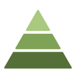
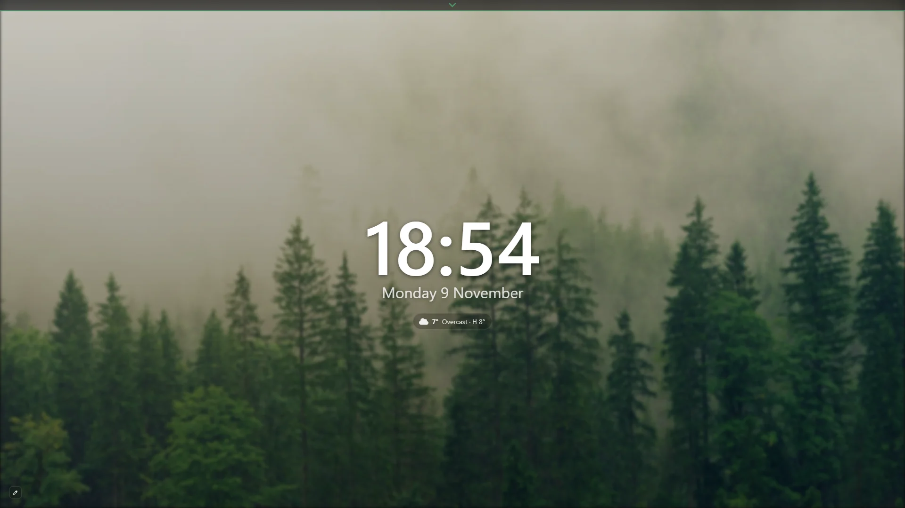
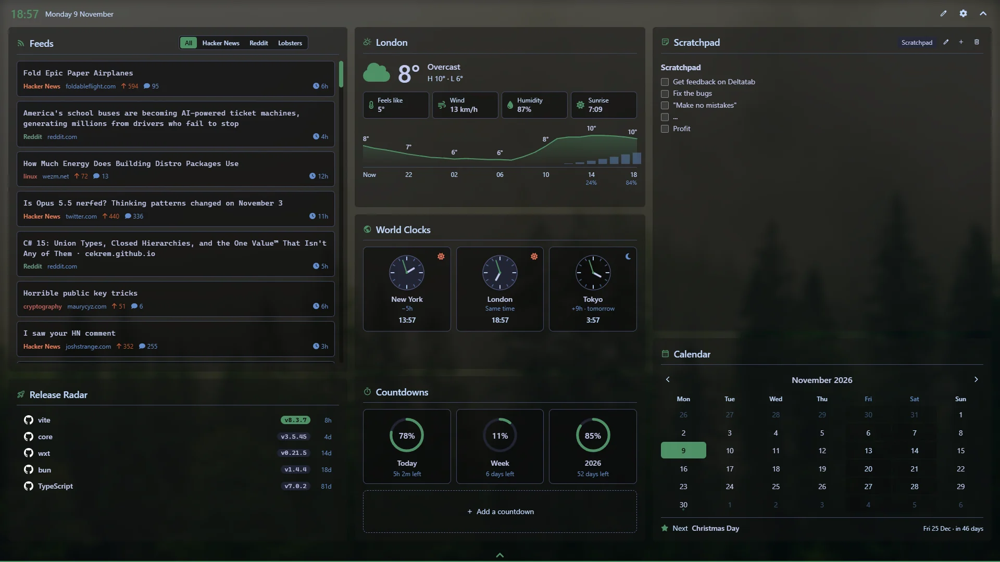

#  Delta Tab

A beautiful new tab experience with a daily new wallpaper (or randomly selected from your own background images), the time, and a pull-down dashboard of the widgets you choose. Use as much or as little as you like.

[Chrome Web Store](https://chromewebstore.google.com/detail/delta-tab/hfeejhcmcenhcghapkhmcodkjiolbdcg) · [Privacy policy](PRIVACY.md) · [Report a bug](https://github.com/DotoPototo/DeltaTab/issues)

## Install

Install Delta Tab from the [Chrome Web Store](https://chromewebstore.google.com/detail/delta-tab/hfeejhcmcenhcghapkhmcodkjiolbdcg). Requires Chrome 116 or later.

New tabs open on a clean home screen: the wallpaper, a clock and the date. Scroll down, drag the handle at the top or press Ctrl+Space to pull down the dashboard. Esc puts it away.

### Privacy

Delta Tab has no account, no analytics, no advertising and no server of its own. Your settings, notes and wallpapers stay in your browser.

Widgets talk directly to the service they are for, over HTTPS. Weather, Calendar holidays and GitHub ask before sending anything about you, and you can stop each one separately at any time. Browsing history and top sites are optional permissions, asked for only by the widget that uses them, and are read on your device.

The [privacy policy](PRIVACY.md) lists exactly what is sent, to whom and when.

## Feedback

Bug reports and ideas are welcome in [GitHub issues](https://github.com/DotoPototo/DeltaTab/issues).
